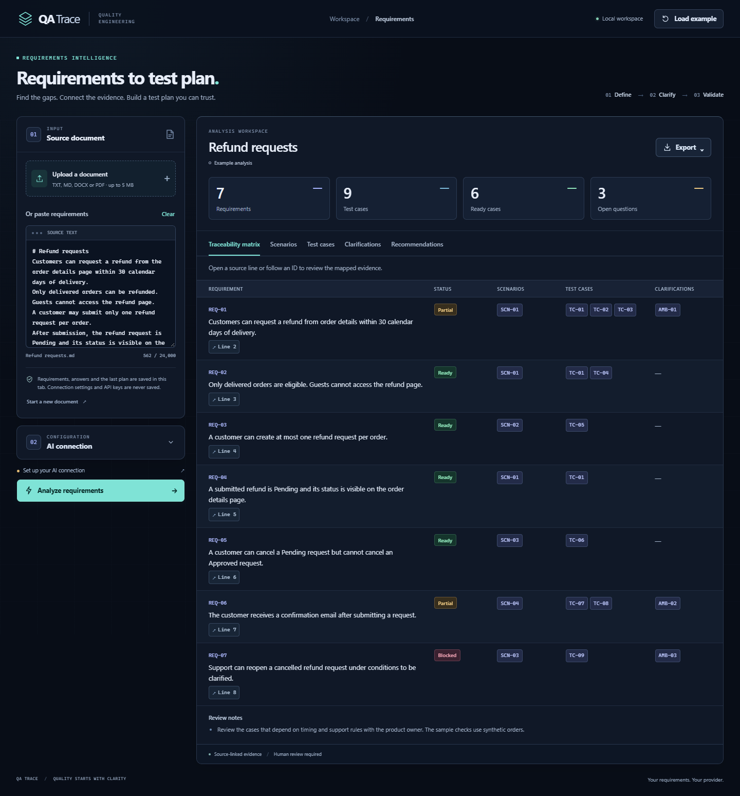

# QA Trace

**Turn a requirements document into a reviewable QA plan.**

Upload a PRD or user stories, connect your own AI key, and review a requirement traceability matrix, scenarios, detailed test cases, clarification questions, and regression/automation recommendations.



The dark workspace separates source input, expandable AI configuration, and source-linked plan review. See the [mobile preview](docs/mobile.png) and [visual design notes](docs/ui-design.md).

The central workflow is **requirement → source excerpt → scenario → case → decision**. When a case depends on an unanswered question, QA Trace leaves its expected result open and defers both recommendations. Other cases on the same requirement can stay ready for review.

## Run locally

Requires **Node.js 22.13+**; Node 24 is recommended.

```sh
git clone https://github.com/akshaytp1571/qa-trace.git
cd qa-trace
npm ci --ignore-scripts
npm start
```

Open **http://127.0.0.1:4173**. The example plan loads immediately and needs no key or external connection. The server binds to loopback only. To change the port in PowerShell:

```powershell
$env:PORT = '4174'
npm start
```

If npm's default cache is unavailable in a confined environment, use `npm ci --cache .npm-cache --ignore-scripts`.

## Analyze your document

1. Upload a document or paste the requirements. Review the extracted text.
2. Expand **AI connection**, or select **Set up your AI connection**. Choose OpenAI, Anthropic, or **OpenAI-compatible gateway** and enter the connection details. Direct providers have a default model; gateways need their base URL and exact model ID. Missing settings are automatically revealed when you analyze.
3. Select **Analyze requirements**. Review the matrix and follow IDs to the scenario, case, or question. Select a line reference to inspect the matching source text.
4. Under **Clarifications**, type answers and select **Analyze with answers**, or use **Save and analyze** beside an answer. Typed replies are saved before the request. You can also choose **Save answer** and analyze later.
5. Review each saved answer's draft status and reason. A follow-up question links to its parent answer and cites text from that answer. Reply and repeat until the remaining questions are clear.
6. Review the regression and automation recommendations, then export CSV, Markdown, or JSON.

### Answer history and preservation

The original requirements and saved answers are kept separately. Each reply has a stable `ANS-…` ID, its question, and an optional parent answer. Reanalysis sends the accumulated history to the model; every saved answer receives an explicit review. Answers remain visible even after their questions disappear from the new draft. **Resolved in this draft** is an AI assessment for human review, not a confirmation from the product owner.

Typed drafts, saved answers, the source document and the latest plan are saved in **session storage for this tab**. They survive tab navigation, canceled/failed requests, reanalysis and refresh. Connection settings and API keys are excluded from this storage and must be re-entered after refresh. Use **Start a new document** to clear this workspace; **Load example** also replaces its answers with a fresh example. If browser storage is unavailable, the page explains that answers can only be kept in memory.

Editing source text or answers makes the old plan stale and disables exports until the next successful analysis. Markdown and JSON exports include reviewed answer history and follow-up links. The combined requirements and answer context are limited to 24,000 characters, with up to 60 saved answers of 1,500 characters each within that combined limit. For an unrelated document, start a new workspace to avoid carrying over previous answers.

See the [clarification follow-up preview](docs/clarifications.png).

Draft recommendations are editable through a revised requirements document and a new analysis. This version does not provide inline editing of generated cases or a multi-user approval process.

### Input and output

| Input | Limit or behavior |
| --- | --- |
| UTF-8 `.txt` and `.md` | Local plain-text extraction |
| `.docx` | Local paragraph/text extraction; formatting is not preserved |
| `.pdf` | Selectable text only; no OCR; at most 100 pages |
| Upload | At most 5 MiB |
| Extracted or pasted text | At most 24,000 JavaScript string characters |

PDF text order follows the extractor. Review tables, columns, and diagrams manually. Image-only and password-protected PDFs are rejected with an explanation.

The model is asked to keep each draft to roughly 12 requirements and 25 cases and disclose omissions. These are prompt targets, not completeness guarantees. Split larger specifications into focused sections.

| Export | Contains |
| --- | --- |
| CSV | Requirement matrix, source excerpts, readiness, and linked IDs |
| Markdown | Matrix, scenarios, cases, questions, reviewed answer history, follow-up links, and both recommendations |
| JSON | The full derived analysis, reviewed answer history and source-name metadata |

Exports include quoted source excerpts, so review them before sharing. The API key and full raw source are not included by the export function.

## What readiness means

- **Ready:** the drafted cases have expected results and no linked blocking dependency.
- **Partial:** the draft mixes ready and blocked cases, has an open blocking question, or a scenario includes a requirement without a case.
- **Blocked:** the drafted cases depend on answers that determine their outcomes.
- **Uncovered:** no cases have been mapped to the requirement or scenario.

These describe the **draft**, not executed tests or complete coverage. Requirements and ambiguities have exact, case-sensitive excerpts checked against the provided source lines. This verifies the excerpt and its location, not whether the model has interpreted the business rule correctly. Human review is required for extraction, mappings, expected outcomes, and prioritization.

## AI connection and data handling

The browser sends the text, selected model, and connection settings to the local Node server. Direct OpenAI and Anthropic requests use fixed provider endpoints. The third option, **OpenAI-compatible gateway**, uses the URL you enter and the native Chat Completions protocol. No agent tools, database, accounts, analytics, or server-side document storage are included.

### Third-party gateways

Select **OpenAI-compatible gateway**, then enter the fields shown in the [gateway setup preview](docs/gateway.png):

- **Base URL** — your gateway's API base. Include a version prefix such as `/v1` when its documentation requires it. The app appends `/chat/completions`; a full Chat Completions URL is also accepted once.
- **Model ID** — the exact identifier offered by that gateway, including a prefix such as `provider/model-name` when required. QA Trace does not guess a gateway model.
- **API key** — sent as `Authorization: Bearer …` when supplied. Leave it blank only if the gateway does not require authentication, such as a local development server.
- **JSON output mode** — start with **JSON object**. Choose **JSON schema (strict)** if the model supports it, or **Prompt only (compatibility)** if the gateway does not accept `response_format`. All modes still pass through the same source and domain validation.

| Example service | API base | Model |
| --- | --- | --- |
| OpenRouter | `https://openrouter.ai/api/v1` | Copy an exact model ID from your account, including the provider prefix |
| DeepSeek | `https://api.deepseek.com` | Copy a currently available model ID from its API documentation |
| Local OpenAI-compatible service | `http://127.0.0.1:1234/v1` | The model ID exposed by that service |

These illustrate configuration, not live service certification. Compatibility depends on the service's Chat Completions implementation, selected model, and account access. Protocol details follow [OpenRouter's reference](https://openrouter.ai/docs/api_reference/overview) and [DeepSeek's quick start](https://api-docs.deepseek.com/).

Remote gateway URLs must use HTTPS. HTTP is accepted only for loopback hosts (`localhost`, `127.x.x.x`, or `::1`). URL credentials, query parameters, fragments, and redirects are rejected. The chosen gateway receives the source and any supplied key; use the credentials issued for that endpoint. Its billing and retention rules apply.

Connection settings are held in the tab and transient request memory. They are not included in analysis exports.

- Keys remain in the tab and transient request memory. The app does not write them to cookies, browser storage, exports, or logs.
- Text is extracted locally. An analysis sends the extracted text to the chosen provider under your account. Your provider's billing and retention rules apply.
- OpenAI requests set `store: false`. This is not a promise of zero provider retention.
- Direct OpenAI/Anthropic requests have a 90-second app deadline. Gateways default to **300 seconds (5 minutes)** and allow 30–300 seconds under **Request settings**. The gateway may impose a shorter upstream limit.
- The default output budget is 16,384 tokens. Gateway request settings allow 1,024–16,384 tokens. A smaller cap can reduce generation time, but an incomplete plan is rejected rather than presented as complete.
- The waiting display shows elapsed time and the app limit. Cancel stops the local wait and aborts the outgoing request; the provider may still charge for work already performed. Errors distinguish the app deadline, upstream HTTP504, and transport failures. There is no automatic paid retry.
- Model IDs were checked against provider documentation on November 19, 2026. Defaults are `gpt-5.4-mini` and `claude-haiku-5-5`. Access depends on your provider account.

Hosted services generally require an API account key; a consumer chat subscription alone may not provide API access. A local gateway may allow keyless requests. This app is a **local, single-user prototype**. Hosting it publicly requires authentication, HTTPS, deployment-specific request limits, and a deliberate approach to document and key handling.

## Architecture

```text
Browser
  ├─ Paste / upload → local extraction endpoint
  ├─ Analyze → provider adapter → structured JSON draft
  │                            ↓
  │                    source + link validation
  │                            ↓
  ├─ Matrix / scenarios / cases / questions / recommendations
  └─ Local CSV / Markdown / JSON download
```

- [HTTP entry point](src/server.mjs) — fixed static routes, bounded bodies, local origin/Host checks, and sanitized errors.
- [Document extraction](src/documents.mjs) — text normalization and bounded DOCX/PDF worker tasks.
- [Plan schema and validation](src/plan.mjs) — validates structure, exact source excerpts, IDs and reference consistency; derives links and readiness; defers blocked-case recommendations.
- [Provider adapters](src/providers.mjs) — native OpenAI Responses, Anthropic Messages, and configurable OpenAI-compatible Chat Completions, with timeout and cancellation handling.
- [Deterministic demo](src/demo.mjs) — synthetic refund example; no AI inference.
- [Browser interface](public/app.js) — DOM text rendering, source viewer, keyboard-accessible tabs, clarification answers, and stale-source handling.
- [Clarification context](src/clarifications.mjs) — validates stable answer IDs, parent order, size limits, and exact answer text locations.
- [Tab workspace](public/workspace.js) — persists only allowlisted document/answer/plan fields in session storage, excluding all connection settings.
- [Exports](public/exports.js) — CSV formula protection, escaped Markdown, reviewed answer history, and intentionally selected JSON metadata.

There is no framework build step. Node's HTTP server, a small browser module, and CSS keep the application easy to inspect. DOCX/PDF parsers are the only production dependencies.

## Verification

```sh
npm test
npm run test:browser
```

On Windows, the browser smoke test uses installed Edge or Chrome. On other systems, install the pinned Playwright browser first:

```sh
npx playwright install --with-deps chromium
npm run test:browser
```

To choose a browser executable in PowerShell:

```powershell
$env:QA_TRACE_BROWSER = 'C:\Program Files\Google\Chrome\Application\chrome.exe'
npm run test:browser
```

The browser check uses a fresh native Playwright browser context, serves the app on an ephemeral local port, exercises the main workflows, and saves screenshots under `artifacts`. It checks representative text-contrast pairs, keyboard tab navigation and focus return, and desktop/mobile overflow. Screenshot bitmap width is checked against the 390px mobile viewport. It uses a mock model response. Provider tests also use mocked responses. **No live AI quality or account-access claim follows from these tests.** See the [test strategy](docs/test-strategy.md) for boundaries and the manual provider check.

The included [GitHub Actions workflow](.github/workflows/checks.yml) is intended for this folder as the repository root. It runs the automated and browser checks and uploads screenshots.

## Two-minute interview demo

1. Open the refund example and follow `REQ-01` to its source and boundary case.
2. Show `TC-03`: the exact day-30 outcome is unresolved. Both recommendations are deferred.
3. Compare it with `TC-01`: the ordinary eligible-order flow is still ready.
4. Add an agreed cutoff answer under `AMB-01`. Explain why changing an answer makes the current plan stale.
5. With your API key, select **Analyze with answers**. Show the retained answer and any follow-up question, then reply again. For a no-key demonstration, use the example to show answer saving and navigation without making a model request.
6. Export the plan and explain what the automated checks do and what still requires a QA review.

This demonstrates requirements analysis, test design, traceability, ambiguity handling, and verification of the tool itself. Do not claim that AI-generated cases establish full coverage.

## Contributing

Bug reports and focused improvements are welcome. Include reproducible steps, expected and actual behavior, and a small synthetic requirements example when possible. Never include API keys, confidential requirements, or customer data in an issue or pull request.

Before submitting a change, run `npm test` and, for browser changes, `npm run test:browser`. Keep source evidence, ambiguity handling, and the distinction between drafted and executed coverage intact. See [CONTRIBUTING.md](CONTRIBUTING.md) for details.

Licensed under the [MIT License](LICENSE).
